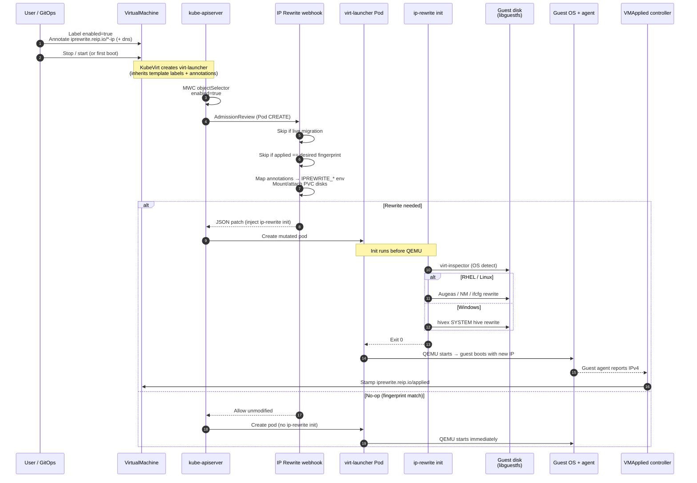
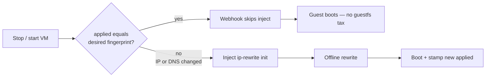

# Architecture

Offline guest IP rewrite for OpenShift Virtualization. The operator intercepts virt-launcher pod creation, injects a libguestfs init container that edits the root disk **before** QEMU starts, then stamps an `applied` fingerprint when the guest agent confirms the new IPv4 — so unchanged restarts skip rewrite.

API and day-2 usage: [user guide](user-guide.md). Examples: [vm-snippet.yaml](../examples/vm-snippet.yaml).

Design inspired by [Soteria IP Rewrite](https://raffaelespazzoli.github.io/soteria/architecture/ip-rewrite/) — see [NOTICE](../NOTICE).

---

## End-to-end flow

### Later restart with the same IP

---

## Components

| Piece | Role |
|-------|------|
| Mutating webhook (`internal/webhook`) | On Pod CREATE with `enabled=true`: skip migration / matching `applied`; otherwise inject `ip-rewrite` init with disk mounts and env |
| Init image (`images/init`) | libguestfs direct backend: OS detect → RHEL (Augeas) or Windows (`virt-windows-ip-rewrite` / hivex) |
| VMApplied controller (`internal/controller`) | When guest agent shows expected IPv4, patch template `applied` fingerprint |
| `IPRewriteConfig` | Cluster config: init image, SCC, `targetNamespaces` (gates **applied** stamping in 0.2.0; see user guide) |

---

## Notes

1. Labels/annotations must sit on **`spec.template.metadata`** so KubeVirt copies them onto the virt-launcher pod.
2. Webhook failure policy is **`Ignore`** (fail-open): if the webhook is down, pods admit without rewrite.
3. Webhook TLS: OLM-injected cert at `/tmp/k8s-webhook-server/serving-certs`, or OpenShift Service CA on kustomize installs.
4. OLM packaging uses CSV `webhookdefinitions` + webhook Service; SCC and sample config are applied outside the registry+v1 bundle — see [olm.md](olm.md).
